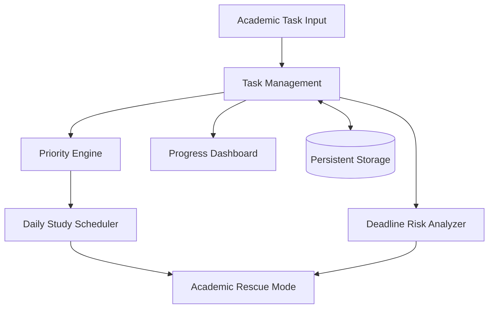

<div align="center">

# AcadWise

### Smart Academic Priority & Recovery System

**Plan Smarter. Prioritize Better. Meet Deadlines.**

<br>


&nbsp;&nbsp;


<br>


&nbsp;&nbsp;


<br><br>

A modular academic planning application built using C.

</div>

---

## Overview

AcadWise is a command-line academic management system designed to help students organize assignments, manage deadlines, and plan their study time more effectively.

Instead of simply maintaining a list of pending assignments, AcadWise evaluates task priorities, checks whether deadlines are achievable, and generates study schedules based on the student's available time.

The project is developed entirely in C, using a modular architecture to keep individual features organized and maintainable.

## Features

| Feature | Description |
|:---|:---|
| Task Management | Add, view, complete, update, and delete academic tasks. |
| Smart Priority Engine | Rank assignments based on urgency, importance, difficulty, and remaining workload. |
| Daily Study Scheduler | Generate study plans according to available study hours. |
| Deadline Risk Analyzer | Identify workload conflicts and deadlines that may be difficult to meet. |
| Academic Rescue Mode | Generate revised schedules for pending assignments. |
| Progress Dashboard | Display task completion, pending workload, and subject-wise statistics. |
| Automatic Deadline Countdown | Calculate remaining days using the system date. |
| Progress Tracking | Record study hours and update remaining task workload. |
| Persistent Storage | Save task records locally with backup and recovery support. |
| Input Validation | Validate user input and prevent invalid task entries. |

---

## Terminal Preview

AcadWise uses an interactive, menu-driven command-line interface.

```text
==================================================
  ACADWISE v1.0
==================================================
  SMART ACADEMIC PRIORITY & RECOVERY
  Plan Smarter. Meet Deadlines.

--------------------------------------------------
  TASK MANAGEMENT

  [1]  Add New Task
  [2]  View All Tasks
  [7]  Mark Task Completed
  [9]  Delete Task
  [10] Update Task Progress

--------------------------------------------------
  SMART PLANNING

  [3]  Smart Priority Ranking
  [4]  Daily Study Scheduler
  [5]  Deadline Risk Analyzer
  [6]  Academic Rescue Mode

--------------------------------------------------
  ANALYTICS

  [8]  Academic Progress Dashboard

--------------------------------------------------
  [0]  Save & Exit
==================================================
```

## System Architecture

AcadWise separates its core functionality into independent C modules. Each module handles a specific responsibility while accessing shared task records through `AcadWise.h`.



The application uses rule-based algorithms rather than external AI services.

---

## Core Algorithms

### 1. Smart Priority Engine

AcadWise calculates a priority score for each pending assignment using four factors:

- **Urgency:** Time remaining before the deadline.
- **Importance:** Academic importance rated from 1 to 5.
- **Difficulty:** Task difficulty rated from 1 to 5.
- **Workload:** Remaining work in hours.

**Priority Formula**

```text
Priority = (4 x Urgency)
         + (3 x Importance)
         + (2 x Difficulty)
         + Workload
```

The workload component uses whole remaining hours, capped at eight.

Tasks with higher scores are ranked first using a sorting algorithm.

### 2. Daily Study Scheduler

The scheduler generates a study plan according to the number of hours available.

It follows these steps:

1. Collect pending assignments.
2. Calculate their priority scores.
3. Sort tasks by priority.
4. Allocate available study hours.
5. Allow partial task allocation when required.

**Scheduling Constraint**

```text
Total Allocated Hours <= Available Study Hours
```

The generated schedule is a recommendation. Task progress is updated separately when the student records actual work.

### 3. Deadline Risk Analyzer

The Deadline Risk Analyzer checks whether the student has sufficient time to complete upcoming assignments.

It compares cumulative workload against available study capacity at each deadline.

**Available Study Capacity**

```text
Capacity = Available Days x Daily Study Hours
```

**Workload Shortfall**

```text
Shortfall = Required Workload - Available Capacity
```

A positive shortfall indicates a potential deadline conflict.

Tasks sharing the same deadline are evaluated together.

### 4. Academic Rescue Mode

Academic Rescue Mode generates a revised study schedule using the current remaining workload.

The system:

1. Identifies pending assignments.
2. Sorts tasks by earliest deadline.
3. Allocates available study hours.
4. Generates a day-by-day recovery schedule.
5. Reports overdue and unscheduled work.

The planner uses an earliest-deadline-first approach and a maximum planning horizon of 30 days.

**Note:** Rescue Mode replans remaining work. It does not automatically detect missed study sessions or change actual task progress.

---

## Getting Started

### Prerequisites

- A C11-compatible compiler such as GCC or Clang.
- A terminal or command-line environment.
- VS Code or another code editor (optional).

### Clone the Repository

```bash
git clone https://github.com/sarthaksuyal/AcadWise.git
cd AcadWise
```

### macOS

Compile:

```bash
clang -std=c11 -Wall -Wextra *.c -o acadwise
```

Run:

```bash
./acadwise
```

### Linux

Compile:

```bash
gcc -std=c11 -Wall -Wextra *.c -o acadwise
```

Run:

```bash
./acadwise
```

### Windows (MinGW-w64)

Compile using PowerShell:

```powershell
gcc -std=c11 -Wall -Wextra *.c -o acadwise.exe
```

Run:

```powershell
.\acadwise.exe
```

The source code is designed for cross-platform compilation. Native testing on each operating system is recommended.

---

## Project Structure

```text
AcadWise/
|
|-- main.c          Main menu and application entry
|-- AcadWise.h      Shared structures and declarations
|
|-- tasks.c         Task management
|-- input.c         Input validation
|-- priority.c      Priority calculation and ranking
|-- scheduler.c     Daily study scheduling
|-- dates.c         Deadline countdown calculations
|-- risk.c          Deadline feasibility analysis
|-- rescue.c        Academic recovery planning
|-- dashboard.c     Progress and workload statistics
|-- storage.c       File handling and data persistence
|-- ui.c            Terminal interface components
|
|-- README.md       Project documentation
|-- .gitignore      Git exclusion rules
```

## Data Storage

AcadWise uses local file handling to preserve task records between sessions.

The current storage format is versioned as `ACADWISE_V1`.

| File | Purpose |
|:---|:---|
| `tasks.txt` | Primary task database |
| `tasks.bak` | Backup of previously saved data |
| `tasks.tmp` | Temporary file used during saving |
| `tasks.dat` | Legacy binary storage format |

Task records include assignment details, deadlines, estimated hours, remaining workload, and completion status.

Local data files, backups, and compiled executables are excluded from version control through `.gitignore`.

---

## Testing

The application can be tested using the following scenarios.

| Test Case | Expected Result |
|:---|:---|
| Add a valid assignment | Task is created successfully |
| Enter an invalid date | Invalid date is rejected |
| Update task progress | Remaining workload decreases |
| Complete an assignment | Status changes to completed |
| Generate a study plan | Allocated hours stay within availability |
| Analyze an impossible deadline | Workload shortfall is reported |
| Run Academic Rescue Mode | Revised schedule is generated |
| Delete an assignment | Task is removed |
| Restart the application | Saved assignments are restored |
| Delete and add tasks | Task IDs remain unique |

These describe expected behavior. Final test results should be verified against the compiled application.

---

## C Programming Concepts

AcadWise demonstrates several fundamental programming concepts:

| Concept | Implementation |
|:---|:---|
| Structures | Represent academic tasks |
| Arrays | Store and process task records |
| Strings | Handle assignment titles and subjects |
| Functions | Separate program functionality |
| Loops | Menu navigation and task processing |
| Conditional Statements | Input validation and deadline decisions |
| Sorting | Priority ranking and deadline ordering |
| File Handling | Persistent storage and recovery |
| Pointers | Access and modify task records |
| Preprocessor Directives | Header guards and constants |

---

## Current Limitations

- Study availability is entered manually.
- Scheduling uses predefined rules rather than AI.
- Rescue Mode does not store historical study sessions.
- Recovery planning is limited to a 30-day horizon.
- File backups improve reliability but do not guarantee atomic recovery after every interruption.
- Cross-platform compatibility requires testing on the target operating systems.

## Future Scope

Potential improvements include:

- A graphical desktop interface.
- Calendar integration.
- Custom study availability for individual days.
- Study-session history.
- Automatic comparison of planned and completed work.
- Desktop notifications and deadline reminders.

---

## Conclusion

AcadWise demonstrates how fundamental C programming concepts can be combined to develop a practical academic planning system.

By integrating task management, priority calculation, deadline feasibility analysis, and recovery scheduling, the project provides students with a structured approach to managing academic workloads.

---

<div align="center">

### AcadWise

**Built with C. Designed for Smarter Academic Planning.**

*Plan Smarter. Prioritize Better. Meet Deadlines.*

</div>
